  
  
  
  

Fourth-year Computer Science student at **Holy Angel University** who loves building fun, useful websites, from the interface all the way down to the database.

### `01 / stack`

| Frontend | Backend | Database | Machine learning |
| --- | --- | --- | --- |
|      |     |    |    |

<code>tools:</code> Git · VS Code · Vercel · Google Colab · Claude Code

### `02 / projects`

| | Project | Links |
| --- | --- | --- |
|  | **SubTrack** Track subscriptions and free trials, see what's about to charge, and decide Keep or Cancel before you pay. <code>React · Express · PostgreSQL · Vercel</code> | [Live&nbsp;↗](https://sub-track-chompd.vercel.app) [Code&nbsp;↗](https://github.com/ChompD/SubAlert) |
|  | **Nepo Mall Issue Reporting System** · *thesis, team* Tenants report facility problems in Taglish; an XLM-RoBERTa model classifies them and an admin reviews each one. I built the web app, the Supabase database layer and the review workflow. <code>HTML/CSS/JS · Supabase · FastAPI</code> | [Live&nbsp;↗](https://thesis-autofill.vercel.app/) [Code&nbsp;↗](https://github.com/EnzoProg-ctrl/Thesis-Autofill) |
|  | **Real-Time PPE Detection** · *team, Modeling Lead* Flags missing hard hats, vests and masks in live video: 0.821 mAP@0.5. <code>Python · YOLOv8 · OpenCV · scikit-learn</code> | [Code&nbsp;↗](https://github.com/pamintuanaj/real-time-ppe-detection) |
|  | **Apolonia's Private Resort** · *school project* Five-page responsive website for my family's private pool resort. <code>HTML · CSS · JavaScript</code> | [Live&nbsp;↗](https://chompd.github.io/Apolonia-s-Private-Resort/) [Code&nbsp;↗](https://github.com/ChompD/Apolonia-s-Private-Resort) |

### `03 / certifications`

Cisco **CCNA: Introduction to Networks** · **Endpoint Security** · **Cyber Threat Management** · **Data Analytics Essentials** · **Introduction to Modern AI** · **AWS Academy Cloud Foundations** · **IBM AI Fundamentals** · freeCodeCamp **Responsive Web Design** and **Relational Databases** · TESDA computer systems and networks courses

[See all 15 on my portfolio ↗](https://dexters-lab-dev.vercel.app/#certifications)
